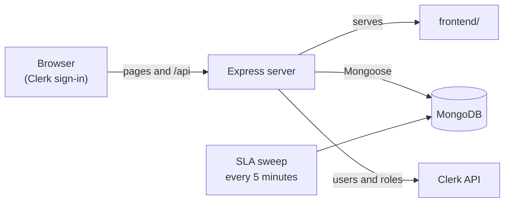

# DeskShark

A help desk and ticketing system. Employees report issues, DeskShark scores their priority, assigns the best-matching technician automatically, tracks SLA deadlines, and escalates tickets that are close to breaching.

> **Related repository:** [CodeShark](https://github.com/Henryyy-R/CodeShark) holds the Terraform and GitHub Actions that deploy DeskShark to Azure.

## Features

**Employees**
- Report an issue with a title, description, category, impact (1-5), urgency (1-5) and the number of people affected.
- Follow their own tickets, add comments, and read the resolution note.
- In-app notifications (a bell that refreshes every 30 seconds).

**Technicians**
- A work queue with each ticket's priority, status and SLA deadline.
- Update a ticket to Assigned, In Progress or Resolved (a resolution note is required when resolving), and post public comments or internal notes.

**Administrators**
- Dashboard with ticket totals, open and resolved counts, and SLA breaches.
- All tickets with a status filter, a priority breakdown, and a technician performance leaderboard.
- CSV exports: tickets, technician performance, and SLA compliance.
- User management (create users, change roles, change email or password) through Clerk.
- Technician profiles (skills, capacity) and editable SLA rules.

## How it works

### Priority

Every ticket gets a score from what the employee reports:

```
score = 5 × impact + 4 × urgency + 3 × affected users
```

| Score | Priority |
|---|---|
| above 70 | Critical |
| above 50 | High |
| above 30 | Medium |
| 30 or below | Low |

### SLA targets

Each priority has a response target and a resolution target. These are the built-in defaults:

| Priority | Response | Resolution |
|---|---|---|
| Critical | 15 minutes | 4 hours |
| High | 1 hour | 8 hours |
| Medium | 4 hours | 24 hours |
| Low | 24 hours | 72 hours |

Admins can edit the targets on the **SLA Rules** tab (**Initialize Default SLA Rules** creates the four rules). A new ticket takes its deadlines from the active rule for its priority, and falls back to the defaults if there is none. Existing tickets keep the deadlines they were created with. Targets use calendar time.

A ticket counts as *responded to* when a technician moves it to In Progress, or when it is resolved without ever being moved there.

### Automatic assignment

When a ticket is created, DeskShark picks a technician:

1. Keep technicians whose skills include the ticket's category and who are below their maximum capacity.
2. Score each one: `50 − 5 × active tickets + 10 × performance rating`, where the rating is the technician's performance score divided by 20.
3. The highest score wins. A tie goes to the technician with the lower workload ratio.

If nobody is eligible, the ticket stays unassigned.

### SLA monitoring and escalation

A background job runs every 5 minutes over every unresolved ticket:

- It flags a **response breach** or **resolution breach** when a deadline passes, and notifies the requester.
- When a ticket reaches **80%** of its resolution window without breaching, it moves to status **Escalated** and the requester is notified once.

### Technician performance

```
score = 0.4 × resolved + 0.3 × customer rating + 0.3 × SLA compliance
```

All three parts are on a 0-100 scale. The resolved part is the number of resolved tickets divided by a target of 20, capped at 100. The score is recalculated each time a technician resolves a ticket.

### Ticket statuses

`Open` → `Assigned` → `In Progress` → `Resolved`, plus `Escalated` (set by the SLA job) and `Closed`.

## Tech stack

- **Backend:** Node.js 22, Express 5, Mongoose 9, node-cron, multer
- **Database:** MongoDB
- **Authentication:** [Clerk](https://clerk.com) (`@clerk/express` on the server, Clerk JS in the browser)
- **Frontend:** plain JavaScript and Bootstrap, served by the same Express server
- **Packaging:** Docker

## Architecture



The SLA job runs inside the server process, so run **one** instance of the server.

### Project structure

```
backend/
  server.js            Express app, route mounting, startup
  routes/              One router per area (tickets, users, admin, reports, ...)
  controllers/         Request handlers
  models/              Mongoose models (Ticket, Technician, User, Comment, Notification, SLARule)
  utils/               Priority, SLA, assignment, escalation and performance logic
  jobs/ticketMonitor.js  The 5-minute SLA sweep
  middleware/          Upload handling and role middleware
frontend/
  index.html           Sign-in page
  app.html             Shell that loads the view for the signed-in role
  admin/ employee/ technician/   One page and script per role
  shared/              API helper, shared app script, styles
Dockerfile             Production image
docker-compose.yml     Local MongoDB only
```

## Getting started

### Prerequisites

- Node.js 22
- MongoDB (local, or a MongoDB Atlas cluster)
- A [Clerk](https://clerk.com) application

### 1. Install

```bash
cd backend
npm install
```

### 2. Start a database

For local development, the repository includes a compose file that runs MongoDB:

```bash
docker compose up -d
```

It publishes port 27017 with no authentication, so use it for local development only. Its connection string is `mongodb://localhost:27017/deskshark`.

### 3. Configure

Create `backend/.env`:

```
MONGO_URI=mongodb://localhost:27017/deskshark
CLERK_PUBLISHABLE_KEY=pk_test_...
CLERK_SECRET_KEY=sk_test_...
PORT=5000
```

| Variable | Required | Description |
|---|---|---|
| `MONGO_URI` | yes | MongoDB connection string |
| `CLERK_PUBLISHABLE_KEY` | yes | Clerk publishable key (the browser fetches it from `/api/config`) |
| `CLERK_SECRET_KEY` | yes | Clerk secret key, used by the API and for user management |
| `PORT` | no | Port to listen on (default `5000`) |

### 4. Set up Clerk roles

DeskShark reads each user's role from Clerk. The API looks for `role` inside the `metadata` claim of the session token, so the token has to include the user's public metadata, for example by adding this under **Sessions → Customize session token** in the Clerk dashboard:

```json
{ "metadata": "{{user.public_metadata}}" }
```

Valid roles are `employee`, `technician` and `admin`. Users without a role are treated as employees. To create the first administrator, set `{ "role": "admin" }` in that user's public metadata in the Clerk dashboard. After that, admins can create users and change roles from the **User Management** tab.

A technician needs two things: a user with the `technician` role, and a profile on the **Technicians** tab whose **name matches the Clerk username exactly**.

### 5. Run

```bash
npm start
```

Open http://localhost:5000, which redirects to the sign-in page.

### Optional: seed technicians

```bash
node seedTechs.js
```

This **deletes all existing technician profiles** before inserting sample ones, so use it only on a local database.

## Docker

```bash
docker build -t deskshark .
docker run -p 5000:5000 --env-file backend/.env deskshark
```

The image runs as the unprivileged `node` user and serves on port 5000. `.env` files are excluded from the image, so pass configuration at run time. Inside a container, `localhost` is the container itself, so point `MONGO_URI` at a host the container can reach.

## API overview

All endpoints sit under `/api` and require a signed-in user unless noted.

| Area | Endpoints |
|---|---|
| Health | `GET /api/health` (no sign-in) |
| Tickets | `GET /tickets`, `POST /tickets`, `GET /tickets/all`, `GET /tickets/:id`, `PUT /tickets/:id/status`, `PUT /tickets/:id/resolve`, `GET` and `POST /tickets/:id/comments` |
| Users | `POST /users/sync`, `GET /users/me` |
| Notifications | `GET /notifications`, `GET /notifications/count`, `PUT /notifications/:id/read`, `PUT /notifications/read-all` |
| Technicians | `GET /technicians`, `GET /technicians/:id`; admin only: `POST`, `PUT /:id`, `DELETE /:id` |
| SLA rules | `GET /sla`; admin only: `PUT /sla/:id`, `POST /sla/init` |
| Reports | `GET /reports/dashboard`; admin only: `GET /reports/export/tickets`, `/technicians`, `/sla` |
| Admin | all admin only: `GET` and `POST /admin/users`, `PUT /admin/users/:id/role`, `PUT /admin/users/:id/credentials`, `DELETE /admin/users/:id` |
| Uploads | `POST /uploads` (multipart field `attachment`; images and PDFs up to 5 MB) |

Uploaded files are served from `/uploads/<name>` for signed-in users and stored with random names. In the container they are written to `/app/backend/uploads`, so mount persistent storage there if files must survive restarts.

## Deployment

The `release` workflow in this repository runs on every push to `main`. It builds the Docker image and pushes it to a private Azure Container Registry, tagged with the first 12 characters of the commit SHA. It does not deploy anything.

Deploying a version is done in [CodeShark](https://github.com/Henryyy-R/CodeShark), the infrastructure repository: a pull request there changes the image tag for staging, and later for production. That keeps every deployment a reviewed change with a visible Terraform plan.

## Known limitations

- **No automated tests yet.** `npm test` is a placeholder. The `backend/test*.js` files are manual scripts that run against whatever database `MONGO_URI` points to, so run them only against a local one.
- **Ticket-level access control is not enforced yet.** Role checks cover the admin and technician-management endpoints. Ticket, comment and notification endpoints only require a signed-in user, and do not yet restrict a ticket to its requester or assigned technician.
- **No attachment field in the ticket form.** The upload API exists, but the form does not use it yet.
- **One server instance only**, because the SLA job runs inside the process.
- **Open CORS, no rate limiting and no security headers** on the API.
- **Technician profiles are matched to Clerk users by name**, not by ID.
- **The priority score depends strongly on the number of affected users**, and is not capped. For example, a full outage affecting one person scores Medium, while a trivial issue affecting 24 people scores Critical.

## License

`backend/package.json` declares the ISC license. A `LICENSE` file has not been added yet.